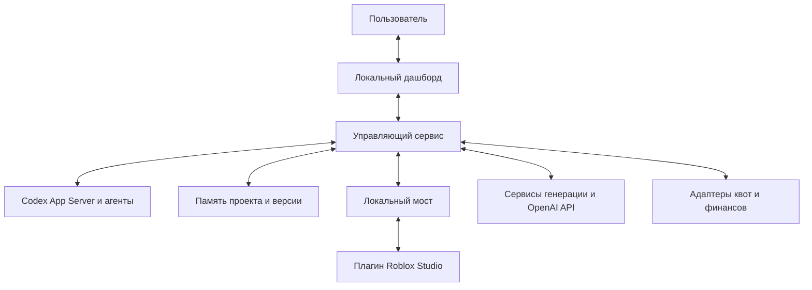

Версия 1.4  
Дата 1 ноября 2026 года  
Назначение — требования к реализации локального дашборда, системы ИИ агентов и плагина Roblox Studio.

Дополнение пользователя от 2 ноября 2026: проект автоматически использует Roblox навыки при разработке; весь интерфейс создаваемых игр изначально на английском, с заложенным автоматическим переводом Roblox. Это обязательное сквозное требование, включая варианты оформления, HUD, меню, магазин, инвентарь и динамические сообщения. Подробности реализации и проверки — [GAME_LOCALIZATION.md](GAME_LOCALIZATION.md).

Система предназначена для личного локального использования и должна превращать выбранную рыночную возможность в небольшую законченную Roblox игру через управляемый пользователем процесс: исследование трендов, краткую концепцию, предпросмотр оформления, утверждение подробной спецификации, автономную разработку, тестирование и доработки. После релиза пользователь оценивает метрики в дашборде и при успехе запускает расширение контента. Публичный выпуск каждой версии подтверждает пользователь.

# Зафиксированные решения

| Область | Требование |
| --- | --- |
| Назначение | Личный локальный инструмент на Windows для аккаунтов и проектов пользователя |
| Масштаб первой версии | Поддержка разных жанров и создание небольших законченных игр с нуля с возможностью расширения контента |
| Центр управления | Единый локальный дашборд; все плановые изменения игры выполняются через него |
| Исполнение в Roblox | Плагин Roblox Studio с локальным мостом; Studio используется пользователем для просмотра и тестирования |
| Основной доступ к ИИ | Личный аккаунт пользователя ChatGPT через Codex; GPT/Codex является основным способом разработки |
| Автономность | После утверждения спецификации и бюджета система создаёт, проверяет и исправляет игру без ручных правок кода и сцены |
| Участие пользователя | Выбор ниши, утверждение стиля, спецификации и бюджета, фидбек, короткая проверка на телефоне и подтверждение публичного релиза |
| Порядок согласований | Краткая концепция → варианты оформления → проверка выбранного стиля в Studio → окончательная спецификация и бюджет → производство |
| Игровое оформление | Пакеты стиля на основе актуальных Roblox референсов, включающие мир, персонажей и игровой интерфейс |
| Навыки агентов | Версионируемый набор Roblox навыков с распределением по ролям и проверкой совместимости |
| Расходы | Сначала оценка стоимости, затем лимит пользователя; дополнительные платные сервисы применяются с обоснованием в рамках согласованного бюджета |
| Доработки | Постоянный цикл изменений по фидбеку на всех этапах и после релиза |
| Аналитика и рост | Метрики и рекомендации в дашборде; расширение контента запускает пользователь |
| Работа в фоне | Закрытие окна дашборда не останавливает сервис на включённом и не спящем компьютере |
| Финансы | Баланс OpenAI API, бесплатные кредиты и расходы; недоступность автоматического баланса допускает ручной режим и не блокирует приёмку |
| Квоты | Доступная квота ChatGPT и Codex с датами сброса в дашборде |
| Качество релиза | Обязательные проверки пройдены, блокирующие ошибки устранены; небольшие известные недочёты раскрываются пользователю и допускаются по его решению |

Под клоном трендовой игры здесь понимается самостоятельная реализация востребованных механик с собственными кодом, оформлением, названием и контентом. Исследование референсов должно приводить к отличиям, которые фиксируются в концепции игры.

# Результат разработки игры

Для каждого проекта система должна формировать:

- исходный проект и открываемую в Roblox Studio сборку;

- серверную и клиентскую логику;

- карту, окружение, необходимые 3D модели, материалы и текстуры;

- интерфейс, управление, анимации, эффекты и звук в объёме спецификации;

- игровую экономику, сохранения и монетизацию;

- название, описание, иконку и изображения для страницы игры;

- сценарии проверки и отчёт о результатах;

- историю требований, замечаний, изменений, версий и расходов;

- подготовленную к подтверждению релизную версию.

Коммерческие показатели выпущенной игры измеряются отдельно от технической приёмки. Завершение разработки подтверждается выполнением спецификации и проверок.

# Границы первой версии

Первая версия реализует весь конвейер для нескольких жанров. Контрольный набор для проверки универсальности: obby, симулятор с прогрессией и раундовое выживание. Каждый контрольный проект представляет собой небольшую законченную игру с рабочими механиками, оформлением, интерфейсом, сохранениями и покупками в объёме утверждённой спецификации. Это набор приёмочных проектов, а не ограничение архитектуры одним жанром.

Каждая новая игра создаётся из пустого проекта под утверждённую концепцию. Разрешается переиспользовать общие инфраструктурные модули: сохранения, покупки, сетевое взаимодействие, телеметрию и тесты. Готовый жанровый шаблон не должен быть обязательной основой генерации.

Первый релиз содержит ограниченный объём контента при законченных основном цикле и интерфейсе. Архитектура игры предусматривает последующее добавление уровней, зон, предметов и активностей по её спецификации без обязательного пересоздания проекта. Существующие сохранения учитываются при расширении; необходимые миграции входят в план обновления.

Система первой версии создаётся для личного локального использования на компьютере пользователя с его аккаунтами и проектами Roblox. Стартовая платформа дашборда — Windows, язык интерфейса — русский. Целевые устройства и языки конкретной игры фиксируются в её спецификации; по умолчанию предусматриваются компьютер и телефон.

В обязательный объём первой версии входят аналитика собственных выпущенных игр в дашборде, рекомендации по развитию и расширение контента по поручению пользователя. Массовая публикация, рекламные кампании и самостоятельный запуск изменений выпущенной игры по коммерческой аналитике остаются за пределами обязательного объёма.

# Пользовательский процесс

| Этап | Работа системы | Результат и действие пользователя |
| --- | --- | --- |
| Настройка | Проверка аккаунтов, разрешений, подключённой Studio, квот и бюджета | Подключённый проект и выбранные режимы |
| Исследование | Поиск игр, сбор показателей и наблюдение за динамикой | Рейтинг направлений с отметкой предварительных выводов при недостатке истории |
| Выбор ниши и краткая концепция | Сравнение конкурентов и сложности производства, описание основного игрового цикла и необходимых экранов | Пользователь выбирает нишу и концепцию |
| Оформление | Подготовка 3–5 сопоставимых вариантов и проверка выбранного стиля на небольшой сцене с работающим интерфейсом в Studio | Пользователь утверждает стиль |
| Спецификация и бюджет | Подробная проработка геймплея, объёма контента, критериев проверки и оценки расходов; при необходимости прототип механик | Пользователь утверждает окончательную спецификацию и задаёт лимит |
| Разработка | Генерация, сборка, тестирование и исправления без ручных правок кода и сцены | Играбельная версия с результатами проверок |
| Фидбек | Анализ замечаний и выполнение доработок | Пользователь просматривает новую версию |
| Подготовка релиза | Проверка сборки, ресурсов, товаров и материалов страницы, подготовка короткого сценария для телефона | Пользователь проверяет версию на реальном телефоне; система исправляет замечания |
| Публикация | Выпуск именно подтверждённой версии с раскрытыми известными недочётами | Пользователь подтверждает публичный релиз; сохраняются ссылка и запись о выпуске |
| Аналитика | Получение доступных метрик собственной игры, показ динамики и рекомендации | Пользователь оценивает результат релиза |
| Расширение контента | Подготовка объёма обновления и оценки расходов по решению пользователя, разработка и проверки | Пользователь согласует расширение и подтверждает публикацию следующей версии |

Пользователь может вернуться к предыдущему этапу. Система показывает, какие результаты и согласования затронуты, и пересчитывает связанные задачи.

# Архитектура системы

## Основные компоненты

| Компонент | Ответственность |
| --- | --- |
| Локальный дашборд | Интерфейс проектов, исследований, предпросмотров, согласований, фидбека, финансов и аналитики выпущенных игр |
| Управляющий сервис | Очередь задач, зависимости, постоянная память, версии, ограничения и исполнение команд в том числе при закрытом окне дашборда |
| Codex App Server | Сессии агентов, доступ к моделям через аккаунт, вызовы инструментов и события выполнения |
| Локальные инструменты агентов | Исследование, работа с файлами, генерация ресурсов, сборка и тестирование |
| Реестр навыков | Источники, закреплённые версии, совместимость, зависимости и назначение навыков агентам |
| Каталог игровых стилей | Семейства стилей, актуальные референсы, версии пакетов и правила визуальной проверки |
| Плагин Roblox Studio | Чтение и изменение сцены и скриптов, импорт ресурсов и проведение проверок |
| Адаптеры провайдеров | Поиск, генерация изображений, 3D, анимаций и звука, OpenAI API, финансовые данные и аналитика Roblox |
| Хранилище проекта | Основные версии проекта, спецификации, ресурсы, результаты задач, логи, отчёты и снимки метрик |



Дашборд и состояние проекта находятся на компьютере пользователя. Запросы к облачным моделям и сервисам отправляются выбранным провайдерам.

Управляющий сервис продолжает работу в фоне после закрытия окна дашборда, пока компьютер включён и не спит. Для сборки и тестирования требуется подключённая Studio. При её недоступности связанные задачи ожидают подключения, а независимые работы могут продолжаться. После возвращения в дашборд пользователь видит актуальный прогресс и ожидающие решения.

## Разделение решений и исполнения

Оркестратор предлагает план, назначает исполнителей и анализирует результаты. Управляющий сервис проверяет команды, контролирует бюджет, хранит состояние и применяет правила согласований. Ограничение публичной публикации обеспечивается кодом сервиса.

Ориентир реализации: TypeScript для дашборда и локального сервиса, React для интерфейса, SQLite для структурированных данных, файловое хранилище для ресурсов, Luau для плагина. Конкретные версии закрепляются после технического прототипа.

## Связь с Roblox Studio

Плагин устанавливает исходящее соединение с локальным сервисом через localhost, получает задания и возвращает результаты. Использование localhost плагинами поддерживается Roblox. [Документация HttpService](https://create.roblox.com/docs/cloud-services/http-service).

Каждая команда должна содержать идентификаторы проекта, целевого подключения Studio, задания и базовой версии. При нескольких открытых Studio пользователь видит выбранное подключение. Изменения не отправляются в неподтверждённый проект.

Плагин должен предоставлять операции чтения структуры и скриптов, применения изменений, импорта ресурсов, управления проверками, получения логов и изображений. Он также показывает подключение, текущую задачу и кнопку остановки.

# Подключение аккаунта ChatGPT и OpenAI API

## Основной режим через аккаунт пользователя

В дашборде должна быть кнопка «Подключить ChatGPT». Авторизация выполняется в официальном браузерном процессе Codex. Пароль не вводится в дашборд и не передаётся плагину.

Основной агентный движок — локальный Codex App Server. Дашборд управляет его сессиями, показывает события выполнения, поддерживает продолжение и прерывание задач. Соединение управляющего сервиса с App Server — локальное stdio. Доступность моделей проверяется для подключённого аккаунта. [Codex App Server](https://learn.chatgpt.com/docs/app-server).

В настройках показываются аккаунт, рабочее пространство, доступный режим авторизации и состояние подключения. Выход и смена аккаунта должны останавливать новые запросы и исключать смешивание квот и результатов разных аккаунтов.

Интеграция закрепляется на проверенной версии Codex и её схемах протокола. Используемые экспериментальные возможности проходят проверку совместимости перед обновлением.

## Дополнительный режим через API

Пользователь может отдельно подключить OpenAI API и выбрать организацию и проект для расходов. API ключ генерации и доступ к финансовым данным хранятся раздельно. Вход в ChatGPT сам по себе не означает наличие прав на финансовые данные API организации.

Переход с подписочного доступа на API по исчерпании квоты по умолчанию выключен. Его можно заранее включить с лимитом расходов. Активный режим всегда виден в дашборде. [Авторизация Codex](https://learn.chatgpt.com/docs/auth).

Для подходящих задач предусматривается прямой адаптер Responses API и отдельных API генерации. Это позволяет использовать доступные API кредиты в рамках правил конкретного гранта. Нельзя считать, что бесплатные API кредиты автоматически оплачивают работу Codex с API ключом: текущая льгота для подписчиков прямо исключает такой расход. [Условия API кредитов](https://developers.openai.com/api/docs/guides/chatgpt-api-credits).

# Агентная система

## Роли

Агент — отдельная рабочая сессия с инструкциями, разрешёнными инструментами, входными материалами и критериями завершения. Роли запускаются по необходимости. Несколько ролей могут использовать одну доступную модель и один аккаунт.

| Роль | Задачи | Результат |
| --- | --- | --- |
| Оркестратор | План, зависимости, распределение работ, разбор ошибок и фидбека | Актуальный план и решения о следующих действиях |
| Исследователь | Тренды, конкуренты, публичные источники и динамика | Исследование с доказательствами и рекомендациями |
| Геймдизайнер | Игровой цикл, прогрессия, экономика, монетизация | Спецификация и параметры баланса |
| Арт директор | Визуальные варианты, правила оформления, проверка согласованности | Утверждённый стиль и задания на ресурсы |
| Разработчик геймплея | Серверная и клиентская логика, сохранения и покупки | Код и проверки |
| Разработчик интерфейса | Экраны, управление, адаптация под устройства | Работающий интерфейс |
| Агент ресурсов | Генерация и подготовка моделей, текстур, анимаций и звука | Проверенные ресурсы и сведения об их происхождении |
| Тестировщик | Игровые сценарии, регрессии, логи и визуальная проверка | Отчёт и задачи на исправление |

Тестировщик получает спецификацию, критерии и фактическую сборку. Сообщение исполнителя об успехе не заменяет проверку.

## Порядок выполнения

После утверждения геймплея оркестратор создаёт план задач с зависимостями. Независимые работы могут выполняться параллельно. Число одновременных исполнителей настраивается с учётом квот, бюджета и мощности компьютера.

Рабочие сессии получают только необходимую часть контекста и согласованную базовую версию. Код и ресурсы готовятся в изолированной области до интеграции.

Изменения сцены проходят через единую очередь сборки. Для пересекающихся файлов и объектов действует блокировка записи. При несовпадении базовой версии система пересчитывает изменение или показывает конфликт.

Основная версия проекта хранится под управлением системы. Все плановые изменения пользователь поручает через дашборд, а Studio использует для просмотра и тестирования. Перед применением изменений система сравнивает сохранённую базовую версию с фактическим состоянием Studio и обнаруживает неожиданные правки.

Цикл разработки: задача → создание результата → проверка формата → сборка → игровой тест → анализ → исправление. Число попыток, время и стоимость ограничиваются настройками. При исчерпании лимитов система сохраняет результаты и состояние задач, сообщает причину остановки и препятствия завершению. Ручное исправление кода или сцены пользователем либо разработчиком не входит в автономный сценарий создания и доработки контрольных игр.

## Контракт задачи

Каждая задача содержит идентификатор проекта и задачи, роль, базовую версию, входные материалы, зависимости, разрешённую область изменений, ожидаемый результат, критерии проверки, лимиты и приоритет. Дополнительно фиксируются идентификаторы и версии применяемых навыков, а для визуальных задач — версия пакета игрового стиля.

Результат содержит статус, созданные или изменённые материалы, версию, выполненные проверки, ссылки на доказательства, фактическое потребление и нерешённые ошибки.

Управляющий сервис проверяет структуру результата. Статус «выполнено» требует существующих материалов и выполнения обязательных проверок.

## Постоянная память

В хранилище проекта сохраняются исследование, утверждённые требования, правила стиля, параметры экономики, каталог ресурсов, план, решения пользователя, фидбек, история изменений и отчёты. Реестр навыков и версии пакетов оформления входят в контрольные версии проекта. Для выпущенных игр дополнительно сохраняются снимки метрик с источниками и временем получения, связи с релизами, рекомендации и решения о расширении контента.

История одной беседы не должна быть единственным источником состояния. После перезапуска система восстанавливает план, версии и незавершённые задачи.

# Интеграция навыков Roblox

## Состав интеграции

Найденные навыки включаются в план реализации как источники специализированных инструкций для агентов. Установка файлов, предоставление инструментов и проверка результата являются разными этапами интеграции. Навык сам по себе не предоставляет доступ к Studio, API или аккаунтам.

| Навык | Источник | Роль и применение | Порядок подключения |
| --- | --- | --- | --- |
| roblox-luau | gamedev-skills/awesome-gamedev-agent-skills | Разработчик геймплея — структура и реализация Luau кода | Базовый набор после проверки полного содержания |
| roblox-datastores | gamedev-skills/awesome-gamedev-agent-skills | Разработчик геймплея — сохранения, восстановление и миграции | Для задач сохранения прогресса |
| roblox-ui | gamedev-skills/awesome-gamedev-agent-skills | Разработчик интерфейса — HUD, меню, магазин, инвентарь и адаптивность | Основной UI навык первой интеграции |
| create-game-assets | gamedev-skills/awesome-gamedev-agent-skills | Арт директор и агент ресурсов — согласованное производство семейств ресурсов | Для визуального производства |
| roblox-building | TabooHarmony/roblox-brain | Агент ресурсов — карта, окружение и размещение моделей | Для задач построения сцены |
| roblox-lighting | TabooHarmony/roblox-brain | Арт директор и агент ресурсов — свет, атмосфера и обработка изображения | Для настройки визуального пакета |
| roblox-gui | TabooHarmony/roblox-brain | Разработчик интерфейса — альтернативные инструкции для игровых экранов | Альтернатива основному UI навыку |
| rbx-device-simulator-lua | Каталог Roblox Studio | Тестировщик и разработчик интерфейса — визуальная проверка на устройствах | Через адаптер Studio при подтверждённой доступности |
| rbx-process-receipt-misuse | Каталог Roblox Studio | Разработчик геймплея и тестировщик — проверка Developer Products | Для задач покупок и их приёмки |
| rbx-scene-analysis | Каталог Roblox Studio | Тестировщик — состав сцены, рендеринг и память | Для проверки собранного мира |

Источники и результаты первоначального чтения зафиксированы в исследовании навыков (локальное приложение проекта: design/ROBLOX_SKILLS_RESEARCH.md). Для внешних библиотек используются [awesome-gamedev-agent-skills](https://github.com/gamedev-skills/awesome-gamedev-agent-skills) и [roblox-brain](https://github.com/TabooHarmony/roblox-brain). Это сторонние зависимости с отдельными лицензиями; навыки из каталога Studio относятся к доступным возможностям подключённого сервиса.

## Реестр и версии

Для каждого навыка сохраняются идентификатор, тип источника, адрес, путь к инструкции, версия или commit, контрольная сумма, лицензия, дата проверки, зависимости, требуемые возможности, назначенные роли и состояние подключения.

Состояния различают найденный, проверенный, установленный, подключённый, несовместимый и отключённый навык. Наличие файлов на диске не считается подтверждением работоспособности.

При подключении читается полный пакет с необходимыми справочниками. Проверяются инструкции, лицензия, зависимости, актуальность API и совместимость с используемой Studio и агентным движком. Для навыка Studio отдельно проверяется возможность получить его через адаптер самостоятельного дашборда; наличие в текущем чате не заменяет эту проверку.

Версии закрепляются для проекта. Обновление сначала проходит проверку на тестовом проекте, затем применяется к новым задачам. Текущая итерация сохраняет исходный набор версий, чтобы результат можно было воспроизвести или откатить.

## Подключение к агентам

Оркестратор выбирает навыки по роли и типу задачи из проверенного реестра. Перед исполнением загружаются основной файл инструкции и необходимые справочники. Все библиотеки целиком в каждую сессию не добавляются.

Для одной UI задачи назначается один основной навык: по умолчанию roblox-ui. roblox-gui может заменить его или использоваться для отдельного дополнительного разбора с явно заданной областью. При пересечении правил управляющий сервис применяет требования проекта и утверждённый пакет стиля.

Правила навыка не расширяют разрешения, бюджет и доступные инструменты и не отменяют решения пользователя. Требование навыка вызвать инструмент проверяется на наличие реализации. При недоступности обязательной возможности задача получает конкретный статус блокировки; система показывает замену или необходимое действие.

В истории задачи видны использованные навыки, версии, выполненные операции и результаты. В настройках проекта доступны просмотр состава, включение и отключение, проверка совместимости и управляемое обновление.

## Проверка интеграции

Для начального набора необходимо продемонстрировать загрузку навыка в рабочую сессию, выполнение профильной задачи и проверку результата в Studio. Для UI проверяются HUD и магазин на целевых устройствах, для сохранений — повторный вход, для покупок — повторная обработка чека, для ресурсов — соответствие стилю и пригодность сцены.

Инструкции для исследования текущих игровых стилей входят в локальную процедуру продукта. Технические навыки помогают реализовать выбранный вариант, а актуальные референсы собираются и проверяются при каждом исследовании.

# Исследование трендов и ниши

Исследование запускается одной кнопкой. Пользователь задаёт период, жанры, масштаб конкурентов и ограничения сложности. Источники подключаются адаптерами с учётом доступности и ограничений запросов.

Собираются доступные сведения: онлайн, посещения, оценки, избранное, даты создания и обновления, позиции в подборках, изображения, описание и видимые товары. Каждая запись содержит источник и время.

Тренд определяется по динамике и устойчивости интереса. Одного значения высокого онлайна недостаточно. Система хранит временные снимки; если истории нет, обозначает это и начинает накопление. Предварительное исследование, сравнение ниш и выбор концепции доступны сразу по имеющимся данным. Недостаток истории и предварительный характер выводов видны пользователю; накопление наблюдений не блокирует его решение начать проект.

Рейтинг направления учитывает рост, устойчивость, насыщенность конкурентами, сложность производства и соответствие ограничениям проекта. Факторы и версия расчёта доступны пользователю.

Факты, выводы модели и численные оценки показываются раздельно. Недоступные выручка и удержание конкурентов не выдаются за известные данные.

Для выбранной ниши система сравнивает несколько конкурентов и предлагает концепции: игровой цикл, аудитория, визуальное направление, отличия, монетизация и оценка производства. Анализ чужой игры использует доступные публичные материалы и наблюдения. Краткая концепция определяет основной игровой цикл и необходимые экраны до подготовки вариантов оформления.

Название, визуальные материалы и содержательные отличия создаются для нового проекта. Сходство с референсами учитывается при проектировании: Roblox указывает, что неуникальные игры могут получать меньше рекомендаций. [Discovery](https://create.roblox.com/docs/discovery).

# Предпросмотр и утверждение оформления

На основе выбранной краткой концепции система создаёт от трёх до пяти пакетов оформления с использованием визуальных подходов реальных Roblox игр на момент исследования. Отбор учитывает нишу, целевую аудиторию и устройства. Основной игровой цикл и необходимые экраны предварительно определяются до сравнения стилей. Стили дашборда и стили создаваемой игры выбираются отдельно.

Начальная рабочая классификация игровых стилей (локальное приложение проекта: design/ROBLOX_GAME_STYLES.md) помогает искать референсы. Это расширяемый каталог: конкретные варианты для проекта формируются заново по исследованию, а их названия сопровождаются ссылками на реальные игры.

## Начальный каталог стилей

| Идентификатор | Направление | Мир и персонажи | Игровой интерфейс | Опорные референсы |
| --- | --- | --- | --- | --- |
| roblox-classic | Классический Roblox | Блочные формы, простые материалы, studs и яркие цвета | Крупные подписи, контрастные счётчики и надписи над объектами | Grow a Garden, Steal a Brainrot |
| toy-cartoon | Полированный мультяшный | Игрушечные объёмы, выразительные существа и насыщенная палитра | Крупные иконки, заметные кнопки, сетки коллекций и цвета редкости | Pet Simulator 99 |
| atmospheric-lowpoly | Атмосферный low poly | Упрощённая геометрия, природные материалы, свет и туман | Сдержанный HUD, показатели состояния и слоты инструментов | Fisch, 99 Nights in the Forest |
| competitive-clean | Соревновательный | Читаемые арены и силуэты, контролируемая детализация | Прицел, счёт раунда, боеприпасы и меню снаряжения | RIVALS |
| anime-action | Аниме экшен | Стилизованные персонажи и оружие, яркие эффекты способностей | Уровень, здоровье, энергия и набор способностей | Blox Fruits |
| fashion-gloss | Мода и глянец | Детализированные аватары, одежда, аксессуары и мягкий свет | Каталоги, категории, палитры, позы и таймер | Dress To Impress |
| grounded-semirealistic | Предметный полуреализм | Узнаваемые дома, интерьеры и транспорт | Функциональные панели строительства и предметные категории | Welcome to Bloxburg |

Это рабочие семейства визуального языка. Они не заменяют жанры и не задают неизменную копию конкретной игры. Подробности и ссылки на источники входят в каталог референсов (локальное приложение проекта: design/ROBLOX_GAME_STYLES.md).

## Сбор референсов и предпросмотр

Каждый референс содержит игру и автора, ссылку, дату проверки, дату или версию визуального материала при наличии, устройство и подтверждённые наблюдения. Система получает материалы текущего игрового процесса, HUD, меню, магазина и инвентаря. Промоизображение не считается доказательством вида игрового интерфейса. Старый материал явно помечается; отсутствие свежего подтверждения отражается в уверенности анализа.

Пакет стиля включает:

- формы, пропорции, материалы и детализацию мира;

- персонажей, силуэты, анимации, эффекты и освещение;

- HUD, главное меню, магазин и инвентарь;

- типографику, иконки, рамки, цветовую иерархию и обозначения редкости;

- состояния кнопок, обратную связь, движение интерфейса и мобильное управление.

Для сравнения используются одинаковые сцена, камера, механики и функции экранов. Варианты должны различаться визуальным языком, моделями, материалами и устройством игрового интерфейса. Одна сцена с несколькими цветовыми фильтрами не выполняет это требование.

Каждый вариант показывает сцену с HUD, отдельные экраны магазина и инвентаря, представление на компьютере и телефоне, источники и объяснение заимствуемых принципов. Концептуальная адаптация для нового проекта отличается по статусу от скриншота референса и снимка реальной сборки. Оригинальные название, код и ресурсы сохраняются как требование.

Перед окончательным утверждением выбранный пакет проверяется на небольшой сцене с работающим интерфейсом в Studio. Пользователь может сочетать совместимые элементы пакетов и дать фидбек. Утверждение связывает мир и интерфейс с одной версией правил; производство и визуальная проверка используют эту версию.

## Данные и использование пакета стиля

Запись пакета содержит идентификаторы семейства, пакета и проекта, версию, статус, референсы и даты, наблюдаемые признаки, правила оформления, ограничения ресурсов, ссылки на предпросмотры, решение пользователя и критерии визуальной проверки.

Правила фиксируют палитру, типографику, формы и рамки, иконки, материалы, масштаб, свет, эффекты, состояния интерфейса и схемы адаптации. Семейство задаёт направление; пакет содержит конкретные решения текущей игры.

Утверждённая версия передаётся арт директору, агенту ресурсов, разработчику интерфейса и тестировщику. Созданный материал ссылается на версию пакета. Обновление правил после фидбека отмечает затронутые модели и экраны и создаёт задачи их согласования.

В дашборде пользователь видит семейство, реальные референсы и даты, сцену с HUD и отдельные игровые экраны. Сравнение поддерживает одинаковые функции экранов и устройства. Карточки содержат фидбек к конкретному элементу и выбор совместимых составляющих, например мира из одного варианта и интерфейса из другого.

Для интеграции должны храниться отдельно каталог семейств, снимки исследованных референсов и версии пакетов проектов. Отсутствующий или устаревший референс не подменяется сгенерированной картинкой под видом фактического игрового экрана.

# Спецификация геймплея

После проверки и утверждения выбранного стиля в Studio, перед основной разработкой, система формирует подробную спецификацию, включающую:

- основной игровой цикл и первые минуты прохождения;

- цели, ограничения, победу и проигрыш;

- прогрессию, награды, ресурсы и экономику;

- структуру карты, режимы и объём контента;

- многопользовательское поведение;

- перечень персонажей, предметов и анимаций;

- экраны, управление и целевые устройства;

- сохранение прогресса;

- монетизацию и влияние покупок на баланс;

- сценарии приёмки и требования производительности.

При необходимости создаётся простой играбельный прототип механик. Финальное производство начинается после утверждения окончательной спецификации, объёма контента, критериев проверки и бюджета. Утверждённые при выборе концепции и стиля решения сохраняются и не запрашиваются повторно.

Утверждение привязано к версии спецификации. Существенные изменения оформляются новой редакцией. Уже явно заданные пользователем решения повторно не запрашиваются.

# Создание контента и сборка

Генерация должна охватывать необходимые проекту модели, текстуры, материалы, интерфейсные изображения, анимации, эффекты и звук. Основной способ разработки — GPT/Codex с доступными выбранному режиму инструментами и процедурным созданием контента. Дополнительные внешние платные сервисы применяются по обоснованной потребности с оценкой пользы и стоимости в рамках согласованного бюджета. Провайдеры выбираются по задаче и качеству; результат одного сервиса можно заменить результатом другого.

Для 3D поддерживаются внешняя генерация, доступные средства Roblox и процедурное моделирование. Проверяются масштаб, ориентация, геометрия, материалы, коллизии, крепления и риг, если он нужен.

Ресурс получает идентификатор, версию, источник, параметры генерации, статус проверки и сведения о допустимом использовании. Загруженные Roblox ресурсы дополнительно связываются с их идентификаторами и состоянием доступности.

Импорт должен учитывать форматы и ограничения актуального интерфейса загрузки. Успешная отправка файла не считается подтверждением его готовности к использованию. [Assets API](https://create.roblox.com/docs/cloud/guides/usage-assets).

Проверяются разрешения целевого experience и результат модерации. Недоступный ресурс не должен оставаться скрытой зависимостью релизной версии. [Ресурсы и модерация](https://create.roblox.com/docs/projects/assets).

Сборка выполняется в целевом проекте Studio. До изменений создаётся контрольная версия; после интеграции проверяется состояние сцены и запускаются связанные сценарии.

# Экономика и микротранзакции

Система разрабатывает схему монетизации вместе с геймплеем, создаёт магазин, карточки, иконки, описания и обработчики.

В обязательный набор входят одноразовые пропуски и повторяемые Developer Products. Для каждого товара фиксируются назначение, выдаваемая ценность, цена, ограничения и идентификатор целевого experience.

Покупки проверяются сервером. Для Developer Products применяется ProcessReceipt с защитой от повторной выдачи. Проверяются отмена покупки, повторный чек, переподключение и сбой сохранения. [Developer Products](https://create.roblox.com/docs/production/monetization/developer-products).

Цены интерфейса должны соответствовать данным платформы, а товары — принадлежать подключённому проекту. Тестовые операции и реальные транзакции учитываются раздельно.

Для облачных проверок и товаров проекту требуется настроенный тестовый experience. Первичная настройка отдельно определяет разрешения на загрузку ресурсов и размещение тестовых сборок. Это не является подтверждением публичного открытия игры.

# Доработки по фидбеку

## Ввод замечаний

Фидбек доступен на любом этапе, во время разработки, после получения сборки и после релиза. Поддерживаются текст, изображения референсов и отметки на скриншотах.

Замечание можно связать с версией, экраном, сценой, объектом или механикой. Примеры: «увеличить кнопки на телефоне», «добавить активности между зонами», «переделать оформление магазина, сохранив механику».

Каждое замечание получает идентификатор, приоритет, статус, исходную версию и связи с задачами.

## Выполнение

Система показывает понимание замечания, определяет затронутые элементы, создаёт задачи, вносит изменения и повторяет необходимые проверки. Пользователь видит сравнение до и после и список связанных изменений.

Само замечание является поручением на доработку в рамках его смысла и доступного бюджета. Дополнительное согласование нужно для неразрешённой неоднозначности, существенного нового объёма или превышения лимита.

Если фидбек поступил во время выполнения, он применяется на безопасной границе задачи. Система проверяет, не устарели ли результаты уже работающих агентов.

Изменение конкретного элемента не должно без необходимости пересоздавать весь проект. Все плановые доработки выполняются через дашборд. Непредвиденные изменения в Studio обнаруживаются сравнением версий и не перезаписываются молча.

## Версии и откат

Каждая итерация сохраняет изменения требований, код, параметры, ресурсы и результаты проверок. Пользователь может сравнить версии, принять результат, продолжить доработку или восстановить контрольную версию.

Откат проекта не означает удаление уже загруженных облачных ресурсов и не возвращает расходы. Изменения схемы сохранений должны предусматривать совместимость или миграцию данных.

После публичного релиза фидбек создаёт следующую версию. Её публикация снова требует подтверждения.

# Аналитика выпущенной игры и расширение контента

Дашборд показывает доступные метрики собственных игр пользователя: активных игроков, удержание D1 и D7, среднюю длительность сессии и выручку. Основной источник — официальный Roblox Analytics Query API с доступом на чтение аналитики целевого experience. Доступ к конкретной игре и нужным показателям подтверждается в техническом прототипе. [Analytics Query API](https://create.roblox.com/docs/cloud/guides/analytics), [поддерживаемые показатели](https://create.roblox.com/docs/cloud/guides/analytics/metrics).

Метрики сохраняются по периодам с источником, временем получения и связью с релизами. Дашборд показывает динамику и доступную свежесть данных. Отсутствующие или ещё не накопленные показатели остаются неизвестными и не подменяются нулём. При недоступности автоматического получения предусмотрен резервный импорт CSV из Roblox с явной отметкой источника и периода. [Экспорт аналитики Roblox](https://create.roblox.com/docs/production/analytics/analytics-dashboard).

Система анализирует доступную динамику и предлагает направления развития, отмечая недостаток данных для уверенных выводов. Пользователь оценивает успех игры и принимает решение о расширении. Сбор метрик и подготовка рекомендаций не являются поручением автоматически менять выпущенную игру.

По решению пользователя система готовит объём расширения контента, оценку расходов и связанные изменения спецификации. После согласования она самостоятельно добавляет контент, выполняет необходимые миграции сохранений и повторяет проверки. Обновление проходит тот же процесс подготовки релиза, проверки на телефоне и подтверждения публикации, что и первая версия.

# Проверка качества

Набор сценариев выводится из утверждённой спецификации. Проверяются запуск, обучение, основной цикл, победа и проигрыш, прогрессия, сохранения, покупки и сетевое поведение.

Обязательны проверки интерфейса на согласованных размерах экрана, переподключения игрока и регрессий после доработок. Для сетевых механик используются многопользовательские сценарии.

Перед публичным релизом пользователь дополнительно проходит короткий сценарий на реальном телефоне: запуск, основной игровой цикл, управление и ключевые экраны. Система подготавливает сценарий и принимает замечания через дашборд, затем самостоятельно исправляет их. Результат проверки связывается с версией сборки.

Производительность проверяется на зафиксированных конфигурациях. До основной разработки указываются целевые устройства, допустимые показатели, число игроков и размеры контрольных сцен. Автоматические проверки в эмуляторе Studio дополняются обязательной пользовательской проверкой на реальном телефоне перед публичным релизом; измерения в эмуляторе не подменяют измерения на реальном устройстве.

Автоматизация использует доступные средства Studio для программных тестов, устройств и ввода. Реальная доступность проверяется в начальном техническом прототипе. [Средства тестирования Studio](https://create.roblox.com/docs/studio/testing-modes).

Отчёт содержит версию сборки, сценарии, результаты, логи, изображения, измерения и нерешённые проблемы. Проверки имеют статусы «пройдена», «не пройдена», «заблокирована» и «не запускалась». Проверка на реальном телефоне дополнительно фиксирует устройство, дату и результат прохождения сценария пользователем.

Автоматический анализ помогает проверять оформление и удобство. Финальное пользовательское восприятие и увлекательность проверяются просмотром сборки и фидбеком.

# Квоты балансы и расходы

## Раздельные показатели

Дашборд должен раздельно показывать:

| Показатель | Содержание |
| --- | --- |
| Квота ChatGPT и Codex | Доступный остаток по каждому сообщаемому окну и дата сброса |
| Дополнительные кредиты Codex | Остаток и условия, если источник предоставляет эти сведения |
| Баланс OpenAI API | Подтверждённый баланс выбранной организации и его состав |
| Бесплатные API кредиты | Выдано, осталось, срок действия и применимость, если доступны |
| Расходы API | Фактические расходы выбранной организации и проекта за период |
| Расходы текущей игры | Локальный учёт по этапам, агентам и провайдерам |
| Бюджет разработки | Лимит, потрачено, зарезервировано и доступно для новых задач |

Процент квоты, долларовый баланс, лимит бюджета и ограничение частоты запросов не суммируются в единый «остаток».

## Квота с датой сброса

Основной источник — интерфейсы аккаунта Codex App Server account/rateLimits/read и события account/rateLimits/updated. Предпочтительно использовать все доступные записи rateLimitsByLimitId; совместимость с одиночным rateLimits сохраняется.

Для каждого окна показываются название, длительность, использованный и оставшийся процент, точные дата и время сброса, обратный отсчёт и время обновления. Если доступно только процентное значение, число оставшихся сообщений не рассчитывается.

Остаток вычисляется как 100 минус usedPercent с ограничением диапазона от 0 до 100. Неизвестное значение остаётся неизвестным. Названия «часовая» и «недельная» используются только при соответствии данным источника.

Время сброса берётся из resetsAt. Оно хранится в UTC и показывается в выбранном часовом поясе. Начальное значение для пользователя — Asia/Bangkok. Обратный отсчёт дополняется абсолютной датой. Достижение даты запускает обновление данных; интерфейс не выставляет 100 процентов сам.

Обновление выполняется при подключении, по событиям, вручную и периодически. Начальный интервал опроса — 60 секунд при активной работе, с ограничением частоты и увеличением пауз при ошибках.

Квоты аккаунта общие для его сессий. Внешнее использование аккаунта может изменить остаток. При потере соединения показываются последние данные, их возраст и статус «данные устарели». [Интерфейс аккаунта App Server](https://learn.chatgpt.com/docs/app-server).

## Баланс API и бесплатные кредиты

Автоматическое получение фактического баланса подключённой API организации выполняется при наличии подтверждённого доступного источника, включая бесплатные и купленные средства в предоставляемом им объёме. Каждое значение содержит организацию, валюту, источник, время получения и статус достоверности.

Бесплатные кредиты различаются по типу гранта. Для каждого доступного гранта показываются остаток, срок действия, ожидаемое следующее начисление при наличии подтверждённой даты и допустимые виды расходов.

У подходящих подписок Pro и Business существует льгота API кредитов с привязкой к принадлежащей пользователю API организации. Наличие, активация и размер именно пользовательской льготы проверяются при подключении. Даты окончания гранта и обновления квоты показываются раздельно. [Условия льготы](https://developers.openai.com/api/docs/guides/chatgpt-api-credits).

Фактические расходы синхронизируются через официальный Costs API при наличии необходимых прав. Этот интерфейс возвращает расходы; он не заменяет источник текущего кредитного баланса. Учёт учитывает пагинацию и выбранную организацию. [Costs API](https://developers.openai.com/api/reference/resources/admin/subresources/organization/subresources/usage/methods/costs).

Источник автоматического баланса и грантов должен быть подтверждён на первом техническом этапе: официальный интерфейс или поддерживаемый коннектор аккаунта; при их отсутствии — разрешённое локальное чтение страницы Billing в авторизованном браузере. Пароль и браузерные cookies не извлекаются в приложение. Чтение страницы должно быть явно видно пользователю как источник и иметь проверку корректного распознавания.

Если для аккаунта автоматическое чтение недоступно, интерфейс показывает «баланс недоступен», ссылку на Billing и возможность сохранить вручную подтверждённое значение с датой. Недоступность автоматического баланса не блокирует приёмку системы и работу остальных возможностей. Учёт расходов и лимиты бюджета сохраняются. Ручное значение явно отличается от автоматической синхронизации; неподтверждённый endpoint не закладывается как готовая интеграция.

Расчётная оценка на основе сохранённого остатка, известных расходов и сроков грантов допускается только с пометкой «оценка». Она не учитывает неизвестные пополнения, списания и использование аккаунта вне приложения.

Для расходов нужны подходящие административные права; обычный ключ генерации не считается достаточным автоматически. Разрешения финансового адаптера должны допускать только необходимые операции чтения.

## Бюджеты и остановка

Перед производством игры система показывает оценку внешних расходов, после чего пользователь задаёт общий бюджет проекта. Заранее фиксированная сумма для всех игр не устанавливается. Оценка отдельно отражает платные запросы ИИ, генерацию моделей, изображений, анимаций и звука, а также покупку ресурсов; стоимость подписки ChatGPT учитывается отдельно.

Настраиваются дневной лимит, ограничения этапов, провайдеров, числа генераций и попыток исправления. До платных предпросмотров и других платных подготовительных задач также согласуется доступный лимит. Перед платной задачей проверяется доступный бюджет и резервируется ожидаемая стоимость; после ответа записывается фактический расход.

Если провайдер не позволяет ограничить стоимость запроса, это учитывается в резерве и возможном отклонении. Суммы по внешним данным и локальные оценки не должны приводить к двойному списанию в учёте.

При исчерпании квоты, бюджета или подтверждённого API баланса новые соответствующие запросы останавливаются. Независимые задачи могут продолжиться. Пользователь видит причину и доступное действие.

Ожидание квоты может возобновлять задачи автоматически, если пользователь включил этот режим и источник подтвердил доступность. Исчерпание средств отличается от временного ограничения частоты; бесконечные повторные запросы исключаются.

Можно включить режим «использовать только подходящие бесплатные API кредиты». Он требует подтверждённой применимости и достаточных свежих данных; при неизвестном или исчерпанном остатке новые API задачи приостанавливаются. Это локальное правило приложения, а не гарантия способа списания со стороны провайдера.

Приближение окончания гранта, малый остаток и достижение порога квоты показываются уведомлениями в дашборде. Приложение не пополняет баланс и не меняет автопополнение.

# Интерфейс дашборда

Обязательные разделы:

- проекты и текущий этап каждой игры;

- исследования и сравнение ниш;

- концепции, стили и предпросмотры;

- спецификация и согласования;

- план и состояние агентов;

- сборка и результаты проверок;

- фидбек и сравнение версий;

- библиотека ресурсов;

- аккаунты, квоты, баланс, кредиты и расходы;

- навыки агентов, их версии и состояние интеграций;

- подготовка и история релизов;

- метрики выпущенных игр, рекомендации и запуск расширения контента.

В верхней области видны активный проект, подключение Studio, режим ИИ, краткий остаток квоты с ближайшим сбросом и доступный бюджет. Карточка финансов раскрывает источники и подробности.

Ход работы показывает фактический текущий этап, задачи, результаты и препятствия. Кнопки паузы, отмены и возобновления доступны из проекта. Закрытие окна не означает паузу или отмену: фоновой работой управляют отдельные явные действия.

На шаге согласования показываются конкретная версия, результат, цена следующего этапа в доступной оценке и действие пользователя. Технические логи открываются отдельно по запросу.

# Варианты макета дашборда

Подготовлены пять вариантов структуры и взаимодействия. Они сохраняют требования этого ТЗ, но по-разному расставляют акценты. Финальное направление выбирает пользователь; наличие варианта в этом разделе не означает его утверждения.

Интерактивная галерея пяти макетов (локальное приложение проекта: design/dashboard-mockups/index.html) позволяет переключать направления и темы. Описание макетов (локальное приложение проекта: design/dashboard-mockups/README.md) фиксирует различия и правила выбора.

| Вариант | Главный экран и сценарий | Превью |
| --- | --- | --- |
| V1 Центр управления | Боковая навигация, этапы конвейера, сборка, состояние агентов и ожидающие решения на одном экране | Макет V1 (локальное приложение проекта: design/dashboard-mockups/command.png) |
| V2 Пошаговая студия | Последовательные этапы с акцентом на выбор стиля, фидбек и согласование перед следующим шагом | Макет V2 (локальное приложение проекта: design/dashboard-mockups/wizard.png) |
| V3 Команда агентов | Доска задач по состояниям, фильтрация по исполнителям и проверяемые результаты | Макет V3 (локальное приложение проекта: design/dashboard-mockups/team.png) |
| V4 Сцена и фидбек | Большой предпросмотр игры, замечания к объектам, обсуждение и переключение версий | Макет V4 (локальное приложение проекта: design/dashboard-mockups/canvas.png) |
| V5 Портфель проектов | Несколько игр на разных этапах, ожидающие решения, выбор проекта и общий доступ к ИИ | Макет V5 (локальное приложение проекта: design/dashboard-mockups/portfolio.png) |

Во всех направлениях предусмотрены аккаунт ChatGPT, квоты с датами сброса, баланс API и бесплатные кредиты. В макетах используются демонстрационные проекты, изображения, суммы и даты; это не сведения о подключённых аккаунтах и не результаты Studio.

Рабочее название интерфейса Forge не фиксирует название продукта. Сочетание структуры одного направления с отдельными экранами другого допускается после выбора пользователя. Основной сценарий, навигация, размещение квот и формат фидбека фиксируются при утверждении итогового макета.

# Состояния и восстановление

Этап проекта и состояние исполнения хранятся раздельно. Исполнение различает работу, ожидание решения, ожидание внешнего сервиса или подключения Studio, ожидание квоты или средств, паузу, ошибку и завершение.

Задачи различают планирование, ожидание зависимостей, очередь, выполнение, проверку, успех, ошибку и отмену.

Зависшие задачи имеют таймаут и ограниченное число повторов. После перезапуска сервиса, пробуждения Windows или переподключения Studio проверяются фактическое состояние проекта и результаты уже отправленных операций. Неопределённый результат загрузки или создания товара сверяется перед повтором, чтобы не создавать дубли.

Отмена останавливает новые действия и по возможности текущие операции. Уже выполненные внешние операции сохраняются в истории.

# Разрешения и сохранность проекта

Локальный сервис доступен через loopback с проверкой подключения и запросов. Плагин и дашборд связываются с конкретным проектом.

Секреты хранятся защищённо на компьютере, отдельно от файлов игры, логов, инструкций агентов и исходного кода. Для агентов доступны только необходимые инструменты и области проекта.

Материалы из веб источников считаются данными для исследования. Они не меняют инструкции, разрешения и правила публикации.

Перед изменением сравниваются базовая и текущая версии. Перезапись пользовательских правок требует разрешения конфликта. Снимки и резервные копии восстанавливаются проверяемым способом.

# Подготовка и подтверждение публикации

Релизная карточка содержит сборку, версию спецификации, результаты обязательных автоматических проверок и проверки на реальном телефоне, изображения, товары, известные ограничения и небольшие неустранённые недочёты с их влиянием на игру.

Подтверждение пользователя связывается с конкретными версией и целевым experience. Изменение сборки после подтверждения делает его недействительным для новой версии.

Публичный выпуск возможен только через проверяемую команду управляющего сервиса с действующим подтверждением. После выпуска сохраняются идентификаторы версии, время, результат и ссылка.

Статус «готово к публикации» требует прохождения обязательных сценариев, включая проверку на реальном телефоне, доступности обязательных ресурсов и отсутствия блокирующих ошибок. Ошибки, мешающие игровому процессу, корректности сохранений, покупок или безопасности, должны быть устранены. Небольшие известные недочёты допускаются к релизу по решению пользователя, который видит их в карточке подтверждаемой версии.

# Этапы реализации

| Этап | Результат |
| --- | --- |
| Технический прототип | Вход ChatGPT, задача агенту, применение в Studio, запуск теста, получение результатов и доработка |
| Подключения и финансы | Чтение квот и времени сброса, проверенный источник API расходов, проверка доступа к балансу и грантам с ручным резервным режимом, проверка доступа к аналитике собственной игры Roblox |
| Основа продукта | Дашборд, проекты, постоянная память, очередь, основные версии проекта, фоновое исполнение и возобновление |
| Навыки и каталог стилей | Реестр и версии навыков, назначение по ролям, семь начальных семейств и структура пакетов оформления |
| Исследование и согласования | Предварительные исследования и наблюдение за трендами, краткая концепция, актуальные игровые референсы, предпросмотры мира и UI, проверка выбранного стиля в Studio, окончательная спецификация и бюджет |
| Производство | Автономная разработка средствами GPT/Codex, агенты кода, интерфейса и ресурсов, сборка и монетизация; дополнительные платные сервисы в рамках согласованного бюджета |
| Итерации и качество | Фидбек, обнаружение неожиданных правок, сравнение, откат, автоматические проверки и короткий пользовательский сценарий на телефоне |
| Приёмка и релиз | Небольшие законченные контрольные игры разных жанров без ручных исправлений кода и сцены, выпуск подтверждённой версии с раскрытием допустимых недочётов |
| Аналитика и расширение | Метрики и рекомендации в дашборде, расширение контента по решению пользователя, проверки и подтверждение следующего публичного релиза |

Недоступная интеграция оформляется как конкретный результат технического этапа с вариантом решения и влиянием на объём. Она не подменяется демонстрационными данными.

# Критерии приёмки

| Область | Проверяемый результат |
| --- | --- |
| Полный цикл | Исследование, краткая концепция, варианты оформления, проверка выбранного стиля в Studio, окончательная спецификация и бюджет, разработка и подготовка релиза доступны в одном дашборде |
| Предварительное исследование | При отсутствии истории видны пробелы и предварительные выводы; пользователь может выбрать концепцию сразу, система продолжает накопление наблюдений |
| Разные жанры | Созданы и проверены три небольшие законченные контрольные игры из пустой сцены без обязательного готового жанрового шаблона; объём каждой определён её спецификацией |
| Автономность | Контрольные игры и их доработки выполнены системой без ручных исправлений кода и сцены пользователем либо разработчиком; пользователь согласует решения, тестирует и даёт фидбек |
| Основной путь GPT/Codex | Создание игры средствами GPT/Codex входит в приёмочные сценарии; дополнительные внешние платные сервисы подключаются по обоснованной потребности и в рамках согласованного бюджета |
| Подключение ChatGPT | Пользователь проходит официальный вход, выполняет агентную задачу и может продолжить её после перезапуска |
| Агентные роли | Независимые задачи выполняются параллельно, результаты интегрируются без конфликтующей записи |
| Навыки | Профильные инструкции реально загружаются по роли; история задачи содержит их версии и результаты проверки |
| Совместимость навыков | Недоступный инструмент обнаруживается до исполнения; замена или блокировка видны пользователю |
| Воспроизводимость навыков | Обновление проходит проверку; предыдущий набор версий восстанавливается вместе с итерацией |
| Игровой результат | Основной цикл, интерфейс, сохранения и тестовые покупки работают по спецификации |
| Игровые стили | Варианты основаны на датированных Roblox референсах и показывают согласованные мир, HUD, магазин и инвентарь; различия выходят за рамки палитры |
| Каталог стилей | Семь начальных семейств доступны для отбора; варианты проекта учитывают нишу и свежесть референсов |
| Версии стиля | Ресурсы и экраны связаны с утверждённым пакетом; после фидбека пересматриваются затронутые результаты |
| Фидбек | Для каждого контрольного проекта выполнены три последовательные доработки через дашборд с сохранением контекста |
| Сохранность | Основная версия проекта хранится под управлением системы; замечание меняет нужные элементы, неожиданная сторонняя правка в Studio обнаруживается и не теряется |
| Откат | Контрольная версия восстанавливается и проходит повторную проверку |
| Проверки | Для каждой сборки есть фактические результаты обязательных сценариев и доказательства |
| Проверка на телефоне | Перед публичным релизом пользователь проходит короткий сценарий на реальном телефоне; версия, устройство, дата, результат и замечания отражены в отчёте |
| Квота | Остатки окон и дата сброса совпадают с источником, учитывают часовой пояс и внешнее потребление аккаунта |
| Неизвестная квота | Отсутствующие поля и сбой связи отображаются как неизвестные или устаревшие данные |
| Баланс API | При доступном подтверждённом источнике автоматически полученный баланс сверяется с Billing выбранной организации; источник и время видны |
| Ограничение баланса | Если автоматическое чтение недоступно, показаны статус, ссылка на Billing и ручное значение с датой; режим не блокирует приёмку и не выдаётся за автоматическую синхронизацию, учёт расходов и лимиты сохраняются |
| Бесплатные кредиты | Тип, остаток, срок и применимость отражают источник; неизвестные поля не заполняются предположениями |
| Расходы | Организационные расходы, расходы проекта и локальные оценки разделены и не учитываются дважды |
| Оценка бюджета | До производства показана оценка внешних расходов и установлен лимит пользователя; подписка ChatGPT учтена отдельно |
| Лимиты | Исчерпание квоты или бюджета останавливает соответствующие новые задачи без потери состояния |
| Платный резерв | API не включается автоматически без заранее заданного разрешения и бюджета |
| Восстановление | Перезапуск сервиса и Studio не приводит к потере прогресса или дублям выполненных операций |
| Фоновая работа | Закрытие окна дашборда не останавливает исполнение на включённом и не спящем компьютере; при недоступной Studio связанные задачи ожидают подключения, после возвращения видны прогресс и решения |
| Аналитика собственной игры | Дашборд показывает доступные метрики с источником, периодом и временем обновления; автоматическое чтение проверено на подключённой игре, импорт CSV явно отмечен как резервный источник |
| Расширение контента | По решению пользователя выполнено расширение контента контрольного проекта с сохранением существующего прогресса или согласованной миграцией; обновление прошло проверки и требует нового подтверждения публикации |
| Рекомендации по развитию | На основе доступной динамики система предлагает направления расширения и отмечает недостаточность данных; решение о запуске принимает пользователь |
| Публикация | Публично выпускается только конкретная подтверждённая сборка |
| Известные недочёты | Блокирующие ошибки устранены, обязательные проверки пройдены; небольшие оставшиеся недочёты перечислены в карточке релиза и приняты пользователем при подтверждении версии |

Численные требования конкретных игр и контрольных проектов к производительности, числу игроков и объёму контента фиксируются в их спецификациях до основной разработки. Денежный лимит пользователь задаёт после оценки стоимости. Настройки стоимости, параллелизма и провайдеров остаются изменяемыми без изменения общего конвейера.

# Передаваемые материалы продукта

Результат реализации системы включает исходный код дашборда и сервиса, устанавливаемый плагин, инструкции запуска и подключения аккаунтов, схемы данных и протоколов, описание адаптеров, проверки основных сценариев и контрольные проекты.

В комплект входят инструкции восстановления и обновления, описание источников квот и финансов, перечень необходимых разрешений и все известные ограничения подтверждённых интеграций. Инструкции также описывают фоновую работу, подключение аналитики Roblox, резервный импорт CSV и подготовку пользовательской проверки на телефоне.

Дополнительно передаются реестр и закреплённые версии навыков, матрица назначения ролям, результаты проверки совместимости, каталог семейств игровых стилей и примеры утверждённых пакетов с миром и интерфейсом. Каталог стилей (локальное приложение проекта: design/ROBLOX_GAME_STYLES.md) и исследование навыков (локальное приложение проекта: design/ROBLOX_SKILLS_RESEARCH.md) являются приложениями к этому ТЗ.

# Приложение Каталог игровых стилей

Дата исследования 1 ноября 2026 года.

Для выбора оформления нужен пакет «мир, персонажи и интерфейс». Приведённые ниже названия — рабочая аналитическая классификация, а не официальные категории Roblox. Она описывает повторяющиеся визуальные подходы на примере существующих игр. Один проект может сочетать признаки нескольких групп.

Популярность, визуальное направление и жанр учитываются отдельно. Наличие игры в подборке не доказывает рост её аудитории, а возраст игры не определяет актуальность конкретного интерфейса. Для каждого нового проекта референсы и их текущий вид проверяются повторно.

## Основные направления

| Направление | Мир и персонажи | Признаки игрового интерфейса | Игры для исследования |
| --- | --- | --- | --- |
| Классический Roblox | Блочные формы, простые материалы, видимые studs, яркие базовые цвета и обычные аватары | Прямые цветовые обозначения действий, крупные короткие подписи, контрастные счётчики и надписи над объектами | Grow a Garden, Steal a Brainrot |
| Полированный мультяшный | Игрушечные объёмы, округлые модели, выразительные существа, чистый свет и насыщенная палитра | Крупные иконки, заметные кнопки, сетки коллекций, цветовые уровни редкости и выразительная выдача наград | Pet Simulator 99 |
| Атмосферный low poly | Упрощённая геометрия с выраженными светом, туманом, природными материалами и настроением | Сдержанный HUD, показатели состояния, слоты инструментов, контекстные подсказки и свободная центральная область | Fisch, 99 Nights in the Forest |
| Соревновательный | Читаемые арены, ясные силуэты, контролируемая детализация, контраст игровых объектов | Прицел, счёт раунда, боеприпасы, минимум отвлечений в матче, структурированные меню снаряжения | RIVALS |
| Аниме экшен | Стилизованные персонажи и оружие, сильные силуэты, яркие эффекты способностей и условные миры | Уровень, здоровье, энергия, набор способностей с клавишами, показатели развития и крупные боевые сообщения | Blox Fruits |
| Мода и глянец | Детализированные аватары, одежда, аксессуары, мягкое освещение и оформление пространства | Каталоги одежды, цветовые палитры, категории, позы, таймер и оценка образа | Dress To Impress |
| Предметный полуреализм | Узнаваемые дома, интерьеры, транспорт, более естественные пропорции и материалы | Функциональные панели строительства, категории предметов, информация о роли и действиях, умеренные эффекты | Welcome to Bloxburg |

Признаки в таблице являются обобщением семейства. Они не означают, что каждый перечисленный элемент присутствует во всех текущих версиях игр.

## Проверенные точки входа

- [Roblox Charts](https://www.roblox.com/charts?SortFilter=default&TimeFilter=0&nl=true) — поиск актуальных референсов и последующая проверка их авторства.

- [Grow a Garden от The Garden Game](https://www.roblox.com/games/126884695634066/Grow-a-Garden) — референс классической блочной среды.

- [Steal a Brainrot](https://www.roblox.com/games/109983668079237/Steal-a-Brainrot) — дополнительный референс для исследования классического Roblox и надписей в игровом мире.

- [Pet Simulator 99 Update 99 от BIG Games, 24 октября 2026](https://www.biggames.io/post/pet-simulator-99-update-99) — официальный материал с примерами инвентаря, магазина и меню.

- [Pet Simulator 99 Update 100 от BIG Games, 31 октября 2026](https://www.biggames.io/post/pet-simulator-99-update-100) — официальный материал текущего обновления.

- [Fisch от Fisching](https://www.roblox.com/games/16732694052/Fisch) — референс стилизованного приключения.

- [99 Nights in the Forest от Grandma's Favourite Games](https://www.roblox.com/games/79546208627805/99-Nights-in-the-Forest) — референс атмосферного выживания.

- [RIVALS от Nosniy Games](https://www.roblox.com/games/17625359962/RIVALS) — референс соревновательного представления.

- [Blox Fruits от Gamer Robot Inc](https://www.roblox.com/games/2753915549/Blox-Fruits) — референс аниме экшена.

- [Dress To Impress](https://www.roblox.com/games/15101393044/Dress-To-Impress) — референс моды и кастомизации.

- [Welcome to Bloxburg от Bloxburg Development](https://www.roblox.com/games/185655149/Welcome-to-Bloxburg) — референс предметной среды и строительства.

Страница игры подтверждает её идентичность и служит точкой входа. Точное устройство текущего HUD и магазина подтверждается отдельными свежими материалами игрового процесса. Для BIG Games доступны датированные официальные примеры интерфейса. Наличие ссылки в этом списке не является результатом полного визуального аудита текущей версии каждой игры.

## Как выбирать варианты для конкретной игры

После выбора ниши исследователь и арт директор отбирают подходящие игры и собирают свежие материалы. Для каждого референса сохраняются источник, автор, дата, устройство, изученный экран и наблюдаемые признаки.

Из наблюдений формируются от трёх до пяти различающихся пакетов. Например, для симулятора можно сравнить классический Roblox, полированный мультяшный подход и атмосферное приключение. Совместимость последнего с геймплеем и аудиторией должна быть обоснована.

Пакеты сравниваются на одном сценарии: одна игровая ситуация, одинаковые функции HUD, одно действие в магазине и одинаковый набор предметов инвентаря. Изменяются геометрия, материалы, свет, персонажи, типографика, форма кнопок, иконки и подача информации.

После выбора система сохраняет правила и проверяет их на работающей сцене и интерфейсе в Roblox Studio.

## Карточка пакета стиля

Каждая карточка должна содержать:

1. Название направления и подходящие жанры.

2. Игры референсы со ссылками и датами проверки.

3. Сцену с HUD и примером персонажа.

4. Магазин и инвентарь.

5. Мобильный вариант и ограничения чтения.

6. Описание форм, материалов, света, шрифтов, иконок и эффектов.

7. Перечень принципов, адаптированных для собственной игры.

8. Статус материала: референс, концепция или сборка Studio.

Стили локального дашборда выбираются отдельно. Спокойный интерфейс управления может показывать как яркую мультяшную игру, так и атмосферный проект.

# Приложение Навыки Roblox

Дата проверки 1 ноября 2026 года. Выполнены поиск через Skills CLI, просмотр исходных репозиториев и содержимого выбранных навыков. Внешние навыки не установлены.

## Доступные через Roblox Studio

Каталог подключённого Studio содержит навыки от Roblox. Для следующих трёх прочитаны подробные инструкции:

| Навык | Назначение для проекта |
| --- | --- |
| rbx-device-simulator-lua | Визуальная проверка игрового интерфейса на устройствах, ориентациях и размерах экрана |
| rbx-process-receipt-misuse | Проверка выдачи Developer Products и обработки чеков |
| rbx-scene-analysis | Анализ состава сцены, рендеринга и памяти |

Это уже доступные возможности текущего подключения. Переносимость в самостоятельный дашборд и необходимые права проверяются при интеграции.

## Внешние кандидаты

Число установок взято из результата Skills CLI. Популярность помогает выбрать кандидатов, но не заменяет проверку содержания и совместимости.

| Навык | Источник | Установки на момент поиска | Применение |
| --- | --- | --- | --- |
| roblox-ui | gamedev-skills/awesome-gamedev-agent-skills | около 5 300 | Реализация HUD, магазинов, инвентаря, адаптивных экранов и управления |
| roblox-luau | gamedev-skills/awesome-gamedev-agent-skills | около 7 500 | Базовая разработка Roblox кода |
| roblox-datastores | gamedev-skills/awesome-gamedev-agent-skills | около 7 000 | Сохранение прогресса |
| roblox-gui | TabooHarmony/roblox-brain | около 2 500 | Альтернативный навык интерфейсов, мобильной компоновки и визуальной проверки |
| roblox-building | TabooHarmony/roblox-brain | около 2 700 | Построение окружения и подготовка игровых объектов |
| roblox-lighting | TabooHarmony/roblox-brain | около 2 500 | Освещение, атмосфера и эффекты обработки изображения |

Дополнительно просмотрен create-game-assets из первой библиотеки: он описывает согласованное производство семейств игровых ресурсов. Это кандидат для арт директора и агента ресурсов.

### Источники и проверка

[awesome-gamedev-agent-skills](https://github.com/gamedev-skills/awesome-gamedev-agent-skills) — сторонняя библиотека с лицензией Apache 2.0. На момент проверки API GitHub показывал 6 353 звезды; последнее изменение 28 октября 2026. Прочитан [roblox-ui](https://github.com/gamedev-skills/awesome-gamedev-agent-skills/blob/main/skills/other-engines/roblox-ui/SKILL.md) и просмотрен [create-game-assets](https://github.com/gamedev-skills/awesome-gamedev-agent-skills/blob/main/skills/disciplines/create-game-assets/SKILL.md).

[roblox-brain](https://github.com/TabooHarmony/roblox-brain) — сторонняя библиотека с лицензией MIT, около 150 звёзд GitHub; последнее изменение 15 октября 2026. Прочитаны [roblox-gui](https://github.com/TabooHarmony/roblox-brain/blob/main/skills/gameplay/roblox-gui/SKILL.md) и [roblox-lighting](https://github.com/TabooHarmony/roblox-brain/blob/main/skills/gameplay/roblox-lighting/SKILL.md). Остальные кандидаты найдены в каталоге и требуют отдельного чтения перед применением.

Содержимое выбранных UI навыков ориентировано на реализацию и проверку интерфейса. Оно не заменяет исследование текущего оформления популярных игр.

### Команды для установки выбранных кандидатов

Команды приведены для последующего решения об установке. В ходе исследования они не выполнялись.

```powershell
npx skills add gamedev-skills/awesome-gamedev-agent-skills@roblox-ui
npx skills add TabooHarmony/roblox-brain --skill roblox-gui
npx skills add TabooHarmony/roblox-brain --skill roblox-lighting
```

Для первого технического прототипа стоит выбрать один основной UI навык, использовать доступные проверки Studio и подключать остальные навыки по роли и задаче.

## Вывод для каталога стилей

В просмотренных материалах не найден готовый проверенный каталог актуальных визуальных стилей Roblox вместе со всеми игровыми экранами. Для этой функции нужны датированные референсы, собственные правила пакетов стиля и регулярное исследование реальных игр. Найденные навыки помогают реализовать и проверить выбранное оформление.

